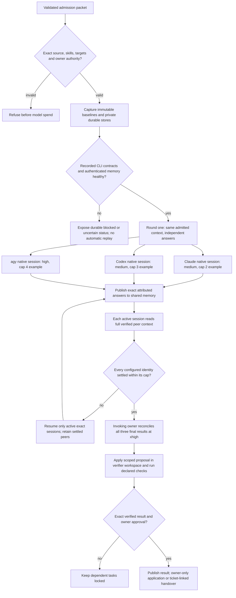

# llm-fanout-execute — native seats and owner reconciliation

The invoking CLI is both orchestrator and merger. Normal Claude, Codex and agy sessions execute admitted work with their installed skills and authorized read tools. Evaluators have the same read capabilities. Shared repository and service writes belong to the owner, not the seats.

| Gate | Kind | Evidence |
|---|---|---|
| G_START | code | `tests/test_fanout_execute_skill.py::test_bare_compiled_write_plan_is_not_an_admission`, `tests/test_fanout_execute_skill.py::test_write_bundle_requires_separate_exact_owner_review` |
| G_PREFLIGHT | code | `tests/test_fanout_execute_skill.py::test_memory_preflight_requires_authenticated_initialized_worker`, `tests/test_fanout_recorded_cli.py::test_recorded_dispatch_refuses_cli_drift_before_intent` |
| G_SETTLED | code | `tests/test_fanout_collaboration.py::test_active_frontiers_keep_settled_peer_revisions_without_relaunch`, `tests/test_fanout_collaboration.py::test_equal_answer_bytes_complete_all_configured_identities_in_cap_one_mode` |
| G_CHECK | code | `tests/test_fanout_owner_actions.py::test_public_owner_preview_completion_and_ticket_handover`, `tests/test_fanout_owner_actions.py::test_public_v1_owner_application_restores_authenticated_verifier_on_cold_reopen` |

Caps range from 1 to 10 per identity; the default is 2. Unequal caps do not manufacture missing turns. Equal answer bytes do not replace missing authors. Observed stability may stop a seat early, but every configured identity remains represented in the final reconciliation. Uncertain or failed attempts consume their recorded budget and are not automatically rerun.

Peer context is complete, attributed, lineage-checked untrusted evidence. Earlier settled revisions remain available to later active seats. Cold recovery authenticates source, baselines, sessions, journals and memory receipts; read-only status does not repair stores or start models. A memory failure is reported as blocked-memory.

The trusted native path is not OS confinement and does not promise credential blindness. Known write tools are denied where the native CLI supports this, with managed policy still applying. Owner application is scoped and drift-checked; sending messages requires separate approval of exact content and destination. Compilation, deterministic tests, live qualification and installation are distinct evidence.
