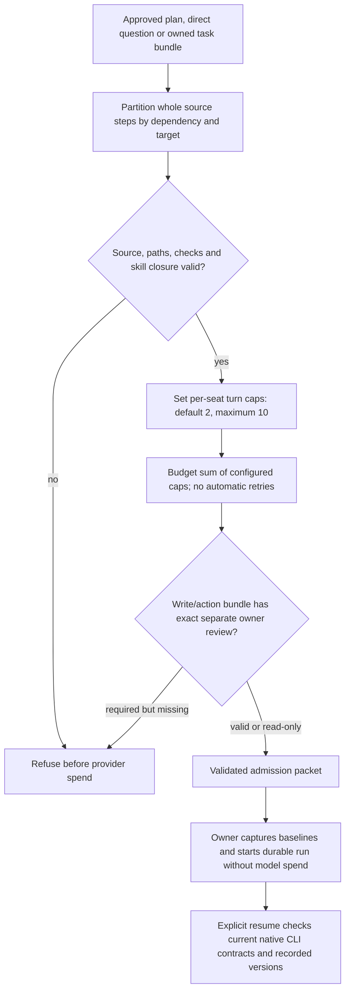

# llm-fanout-plan — admission and compilation

The invoking CLI plans and owns the run. Claude, Codex and agy are configured executor identities within each work task, not extra dependency nodes. Planning and reconciliation use xhigh (Gemini high); execution uses medium (Gemini high). Each configured identity must return a valid final result.

| Gate | Kind | Evidence |
|---|---|---|
| G_COMPILE | code | `tests/test_fanout_plan_skill.py::test_compile_and_validate_recompute_exact_source_and_draft`, `tests/test_fanout_compiler.py::test_compiler_rejects_repo_write_without_owned_paths` |
| G_REVIEW | code | `tests/test_fanout_plan_skill.py::test_write_bundle_requires_digest_bound_owner_review`, `tests/test_fanout_plan_skill.py::test_bundle_cannot_self_assert_its_owner_review` |

Every repository target has explicit identity and ticket-linked branch metadata. The same ticket may span distinct repositories. Artifact dependencies consume verified results; handover dependencies wait for authenticated local branch delivery. Independent work may run concurrently; dependent steps wait.

Workers and evaluators retain normal native skills, configuration, authentication and authorized read tools. They produce evidence or proposals; only the invoking owner applies shared writes. This trusted same-user workflow is not OS confinement. Neither plan admission nor successful tests authorize messages, pushes, deployments or unrelated service changes.
